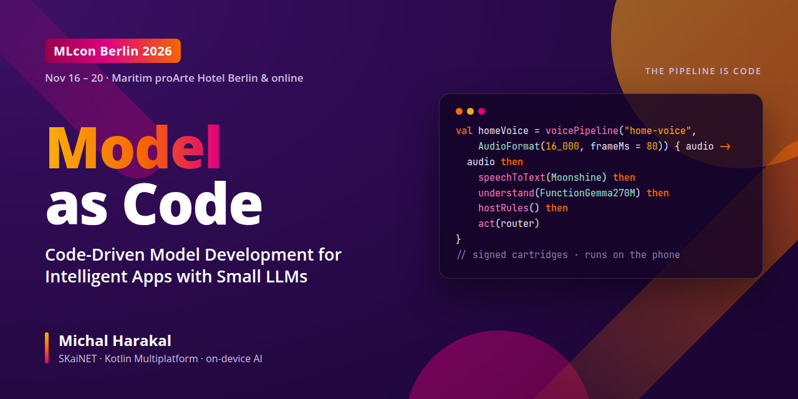

# Model as Code

**Code-Driven Model Development for Intelligent Apps with Small LLMs** · Michal Harakal

Companion app to the talk at **[MLcon Berlin 2026](https://mlconference.ai/berlin/)**, *the event for Generative AI & Machine Learning Engineering*.

| | |
|---|---|
| **Conference** | [MLcon Berlin 2026](https://mlconference.ai/berlin/), part of AI Native Week |
| **When** | Nov 16–20, 2026: bootcamps and workshops Nov 16, 17 and 20, conference days and expo Nov 18–19 |
| **Where** | Maritim proArte Hotel Berlin, or online |
| **Session** | [Model as Code: Code-Driven Model Development for Intelligent Apps with Small LLMs](https://mlconference.ai/ml-ops/model-as-code-small-llms/) (MLOps & LLMOps program) |
| **Speaker** | [Michal Harakal](https://harakal.de/talks/model-as-code-code-driven-model-development-mlcon-berlin-2026) |

## The talk in one paragraph

AI changes the applications we build. Once a small language model runs on the device, the app *is* the model and the pipeline around it, so both deserve the same engineering as the rest of the code. That means typed, reviewed, testable, built reproducibly and shipped as signed artifacts. The talk shows that idea end to end with Kotlin and [SKaiNET](https://github.com/SKaiNET-developers/SKaiNET):
- networks are defined in a Kotlin DSL and traced to StableHLO;
- they are compiled with IREE and packed into signed **model cartridges**;
- they are wired into an app through a pipeline that is itself code;
- a large teacher model passes its knowledge to a ~1B or smaller student **ahead of time**, before anything ships.

## What this repository demonstrates

[**HomeEvenSmarter**](HomeEvenSmarter/) is a smart-home voice assistant. It runs **entirely on the phone**: streaming speech recognition (Moonshine v2) and function-calling understanding (FunctionGemma 270M), both exported from Kotlin model definitions.

- **The pipeline is code.** `voicePipeline { audio then speechToText(…) then understand(…) then hostRules() then act(…) }` is what runs and what the app's panel draws. A stage out of order does not compile. See [`HomeVoice.kt`](HomeEvenSmarter/core/src/commonMain/kotlin/sk/ainet/examples/smarthome/pipeline/HomeVoice.kt).
- **Models are declared, not found.** [`HomeCartridges`](HomeEvenSmarter/core/src/commonMain/kotlin/sk/ainet/examples/smarthome/cartridge/CartridgeExpectation.kt) states what each stage needs: family, version, 16 kHz / 80 ms streaming input, tool-call format and runtime. A pack on the device conforms, or it is refused.
- **Verified before load.** The app checks every cartridge's ed25519 manifest signature against a pinned key and streams every artifact through SHA-256 before a model is loaded. The panel shows id, version, digest and signature per stage.
- **Measured, not claimed.** A golden set of 12 utterances, with arguments asserted, runs on the phone. On a Pixel 8a over Vulkan the pipeline passes 12/12, the model alone passes 10/12, and median NLU latency is 2.2 s.

Built from the [SKaiNET cartridge blueprints](https://github.com/SKaiNET-developers/SKaiNET-cartridge-blueprints) on SKaiNET 0.63.0, SKaiNET-transformers 0.64.2 and IREE 3.11.0.

| | |
|---|---|
| [**HomeEvenSmarter**](HomeEvenSmarter/) | The demo app: Kotlin Multiplatform, Compose, on-device ASR + NLU via SKaiNET/IREE, Ktor companion server |
| [Architecture (C4)](HomeEvenSmarter/docs/c4/) | Context → containers → components, as Mermaid diagrams |
| [Demo flow diagram](HomeEvenSmarter/docs/demo-architecture.svg) | The one-slide version: building blocks, local/cloud border, numbered data flow |
| [Banner source](assets/banner/mlcon-berlin-2026.html) | Rendered with headless Chromium at 1280×640 |

The app grew out of the demo for *From Dumb Client to Hybrid Intelligence* (next.app devcon 2026, Berlin). The MLcon version adds the pipeline-as-code, conformance and verification layers described above.

MLcon is organised by S&S Media. This is a speaker's companion repository, not an official conference page.
